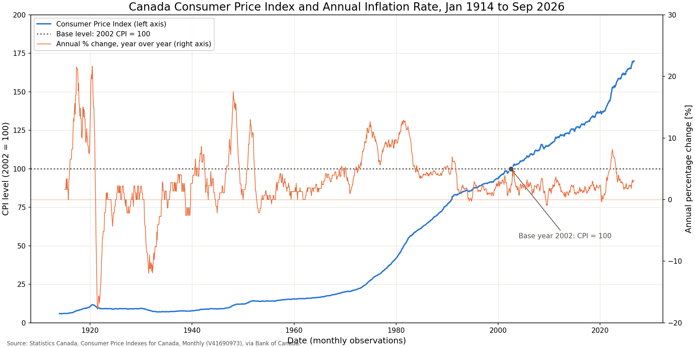

# Bank of Canada Inflation Calculator — Monthly Edition

**FINE 3300 (Fall 2026) · Assignment #2 · Part B: Consumer Price Index**
**Author:** _[Your Name]_ · Schulich School of Business, York University

This project rebuilds the [Bank of Canada Inflation Calculator](https://www.bankofcanada.ca/rates/related/inflation-calculator/) in Python and adds features to it. It reads Canada's monthly Consumer Price Index (CPI) from 1914 to today, graphs it, and answers the question *"What would something that cost $X back then cost now (or at any other date)?"*

The Bank of Canada calculator only lets you choose a **year**, even though the data is **monthly**. This version lets you choose a **month and year** for both dates, checks everything you type, and shows the results in the same layout as the Bank's calculator.

---

## Table of Contents
1. [Project Overview](#1-project-overview)
2. [Files in this Repository](#2-files-in-this-repository)
3. [Data Source](#3-data-source)
4. [Methodology](#4-methodology)
5. [Installation](#5-installation)
6. [How to Use the Calculator](#6-how-to-use-the-calculator)
7. [CPI Graph and Commentary](#7-cpi-graph-and-commentary)
8. [Sample Output](#8-sample-output)
9. [Input Validation](#9-input-validation)
10. [Libraries Used](#10-libraries-used)

---

## 1. Project Overview

The **Consumer Price Index (CPI)** tracks the price of a fixed "basket" of goods and services that households buy: food, shelter, furniture, clothing, transportation and recreation. Statistics Canada publishes it every month. When the CPI rises, the same basket costs more, and that rise is **inflation**.

The program has three parts:

| Step | What happens | Library |
|------|--------------|---------|
| 1. Load & clean | Reads the Bank of Canada CSV file into a data frame, finds where the data starts, splits each date into year and month, and removes two duplicated months | Pandas |
| 2. Analyze | Calculates the annual (year-over-year) % change in CPI for every month | NumPy |
| 3. Visualize | Graphs CPI (left axis) and annual % change (right axis), with a dotted line at the base level (2002 = 100), and saves it as `cpi_graph.png` | Matplotlib |
| 4. Calculate | Asks for a price and two dates, checks the input, and prints the Bank of Canada-style results | Python / NumPy |

---

## 2. Files in this Repository

| File | Description |
|------|-------------|
| `inflation_calculator.py` | The whole program: the `CPIData` class (data loading, graph, calculations), the input-checking functions, and the main program |
| `STATIC_INFLATIONCALC.csv` | Monthly CPI data from the Bank of Canada (CSV format), January 1914 to September 2026 |
| `cpi_graph.png` | The graph made by the program (also shown below) |
| `sample_output.txt` | A full sample session with the calculator, including rejected inputs |
| `requirements.txt` | The Python packages you need to install |
| `README.md` | This write-up |

---

## 3. Data Source

* **Publisher:** Bank of Canada. The data is offered on the calculator page in three formats (CSV, JSON and XML). This project uses the **CSV** file:
  `https://www.bankofcanada.ca/valet/observations/STATIC_INFLATIONCALC/csv`
* **Underlying series:** Statistics Canada, *Consumer Price Indexes for Canada, Monthly* (V41690973), **2002 CPI = 100.0**.
* **Coverage:** 1,353 monthly observations, **Jan 1914 – Sep 2026**. CPI data is released about two months after the month it describes.

**About the file format.** The CSV does not start with the data. It begins with a *TERMS AND CONDITIONS* block, then a *SERIES* description, and only then the *OBSERVATIONS*:

```text
"TERMS AND CONDITIONS"
"https://www.bankofcanada.ca/terms/"

"SERIES"
"id","label","description","date_format"
"STATIC_INFLATIONCALC","Total CPI","Total CPI","monthly"

"OBSERVATIONS"
"date","STATIC_INFLATIONCALC"
"1914-01-01","6.00000000"
...
```

The program reads the file line by line to find the `"OBSERVATIONS"` line and tells Pandas to skip everything above it. Because it searches for that line, the program still works if the Bank adds or removes lines in the header.

**Data cleaning.** Two months appear **twice** in the file: April 1927 (dated `1927-04-01` and `1927-04-30`) and April 1932 (`1932-04-01` = 7.6 and `1932-04-30` = 7.4). The Bank's own calculator keeps the **last** value it reads for each month, so this program does the same (`drop_duplicates(..., keep='last')`). That way its results match the Bank's exactly.

---

## 4. Methodology

The program uses the same formulas as the Bank of Canada calculator:

| Result | Formula |
|--------|---------|
| Cost in the second period | $Cost_2 = Cost_1 \times \dfrac{CPI_2}{CPI_1}$ |
| Percent change | $\%\,Change = \dfrac{Cost_2 - Cost_1}{Cost_1} \times 100$ |
| Number of years | $(\text{months between the dates}) \div 12$, negative if the second date is earlier |
| Average annual rate of inflation | $100 \times e^{\left(\ln CPI_2 - \ln CPI_1\right) / \lvert years \rvert} - 100$, a compound (geometric) annual rate |
| Annual % change (graph) | $\left(\dfrac{CPI_t}{CPI_{t-12}} - 1\right) \times 100$, the same month one year earlier |

**How this improves on the Bank's calculator.** When you type a year into the Bank's calculator, it quietly uses the CPI for the *most recent month of data* in both years. With data up to September 2026, entering "2000 → 2026" really compares **Sep 2000 with Sep 2026**. This program makes the month explicit and lets you choose any month for each date.

**Check against the Bank of Canada.** When both dates use the month the Bank uses (September), this program gives exactly the same results as the live calculator on bankofcanada.ca:

| Inputs | Bank of Canada (year only) | This program (month & year) |
|--------|----------------------------|-----------------------------|
| $100.00, 2000 → 2026 | $176.90 · 76.90% · 26 years · 2.22% | $176.90 · 76.90% · 26.00 years · 2.22% (Sep 2000 → Sep 2026) |
| $100.00, 1914 → 2026 | $2,833.33 · 2,733.33% · 112 years · 3.03% | $2,833.33 · 2,733.33% · 112.00 years · 3.03% (Sep 1914 → Sep 2026) |
| $500,000.00, 2026 → 2000 | $282,647.06 · −43.47% · −26 years · −2.17% | $282,647.06 · −43.47% · −26.00 years · −2.17% (Sep 2026 → Sep 2000) |

---

## 5. Installation

**Requirements:** Python 3.10 or newer, and the packages in `requirements.txt` (NumPy, Pandas, Matplotlib).

```bash
# 1. Clone the repository
git clone https://github.com/YOUR-USERNAME/YOUR-REPO-NAME.git
cd YOUR-REPO-NAME

# 2. (Recommended) create and activate a virtual environment
python3 -m venv .venv
source .venv/bin/activate          # macOS / Linux
# .venv\Scripts\activate           # Windows

# 3. Install the required packages
pip install -r requirements.txt
```

**To use the latest CPI data:** download the CSV from the [Inflation Calculator page](https://www.bankofcanada.ca/rates/related/inflation-calculator/) (click **CSV** next to *Data available as*), name it `STATIC_INFLATIONCALC.csv`, and put it in the project folder, replacing the old file. The program finds the new date range by itself.

---

## 6. How to Use the Calculator

Run the program from the project folder:

```bash
python3 inflation_calculator.py
```

1. The program loads the data and prints a summary, including a check that the 2002 average CPI is 100.0.
2. The **CPI graph opens in a new window** and is saved as `cpi_graph.png`. **Close the graph window to continue.**
3. Enter the **price** of the goods or services. Commas, spaces and a `$` sign are allowed, e.g. `100`, `1,250.50`, `500 000`.
4. Enter the **date of the first period** as `YYYY-MM` (e.g. `2000-09`). A full date like `2000-09-15` also works; the program takes the year and month from it.
5. Enter the **date of the second period** the same way. It can be before or after the first date.
6. Read the results, then type `y` to do another calculation or `n` to quit.

---

## 7. CPI Graph and Commentary



*Blue line (left axis): CPI level. Orange line (right axis): annual % change compared with the same month a year earlier. Dotted line: base level (2002 = 100).*

**Highlights from the data:**

* **Prices are about 28 times higher than in 1914.** The CPI went from **6.0** in January 1914 to **170.0** in September 2026, so a basket that cost $1.00 in 1914 costs about **$28.33** today. The CPI crossed the base level of 100 in mid-2002. Since then prices have risen about 70% more, roughly 2.2% per year.
* **World War I and the 1920–21 crash.** Annual inflation peaked at **21.6%** (June 1920). Within a year it fell to **−17.8%** (mid-1921), the sharpest deflation in the whole data set.
* **The Great Depression.** Prices fell for several years in a row, with annual inflation bottoming out at **−12.0%** in July 1931.
* **World War II price controls.** From 1942 to 1945 the CPI stayed between **8.7 and 9.2**, a nearly flat line while wartime price controls were in place. When the controls were lifted after the war, inflation jumped to **17.5%** (February 1948).
* **The "Great Inflation" of the 1970s and early 1980s.** Annual inflation averaged **6.8%** from 1970 to 1990 and peaked at **12.9%** in July 1981. Prices **doubled in less than nine years** (CPI 20.4 in Jan 1971 → 41.0 in Oct 1979), which is why the blue line turns steeply upward.
* **January 1991: the GST.** The CPI jumped **2.6% in one month** (79.9 → 82.0) when the federal Goods and Services Tax took effect.
* **Inflation targeting (1991 onward).** After the Bank of Canada and the federal government agreed on an inflation-control target in 1991, the orange line settles into a narrow band near 2%. From 1992 to 2020 inflation averaged **1.8%**, and the CPI took about **33 years** to double (85.0 in Jan 1993 → 170.0 in Sep 2026). Only 9 of the 417 months since 1992 had negative annual inflation: the 1994 tobacco tax cuts, the 2009 recession (−0.9%), and the start of the COVID-19 pandemic (−0.4% in May 2020).
* **The 2021–2023 surge.** Inflation reached **8.1%** in June 2022, the highest rate since January 1983. It then came back down toward the 2% target.
* **Most recent data.** Annual inflation rose during 2026, from **1.8%** in February to **3.1%** in September. That is above the Bank's 2% target and just above the top of its 1–3% control range.

---

## 8. Sample Output

All dollar amounts are rounded to the nearest cent and shown with a `$` sign and the `CAD` currency code. The session below shows the calculator rejecting invalid inputs, comparing months (including January 1914, which the Bank's year-only calculator can't do), and going back in time. The full file is [`sample_output.txt`](sample_output.txt).

```text
======================================================================
        BANK OF CANADA INFLATION CALCULATOR (MONTHLY EDITION)
======================================================================
Data loaded: 1353 monthly CPI observations from Jan 1914 to Sep 2026.
Check: average CPI in 2002 = 100.0 (base level should be 100.0)
Saving the graph to cpi_graph.png ... close the graph window to continue.

Enter dates as YYYY-MM (e.g. 2000-09) or YYYY-MM-DD, between Jan 1914 and Sep 2026.

Enter the price of the goods or services (e.g. 100 or 1,250.50): $abc
  Invalid amount. Please enter a positive number (commas and spaces are allowed).
Enter the price of the goods or services (e.g. 100 or 1,250.50): $100
Enter the date of the FIRST period  (YYYY-MM): 2000-09
Enter the date of the SECOND period (YYYY-MM): 2026-09

======================================================================
                     INFLATION CALCULATOR RESULTS
======================================================================
A "basket" of goods and services that cost:
             $100.00 CAD  in Sep 2000
...would cost:
             $176.90 CAD  in Sep 2026
----------------------------------------------------------------------
Percent change:                                                 76.90%
Number of years:                            26.00 (26 years, 0 months)
Average annual rate of inflation (%) /
  Decline in the value of money:                                 2.22%
CPI for first date (Sep 2000):                                    96.1
CPI for second date (Sep 2026):                                  170.0
======================================================================
2002 CPI = 100.0

Would you like to do another calculation? (y/n): y

Enter the price of the goods or services (e.g. 100 or 1,250.50): $-50
  Invalid amount. Please enter a positive number (commas and spaces are allowed).
Enter the price of the goods or services (e.g. 100 or 1,250.50): $1,250.50
Enter the date of the FIRST period  (YYYY-MM): 2027-01
  Jan 2027 is outside the data set. Please enter a date between Jan 1914 and Sep 2026.
Enter the date of the FIRST period  (YYYY-MM): 2000-13
  Invalid date. The month must be between 1 and 12.
Enter the date of the FIRST period  (YYYY-MM): 1914-01-15
Enter the date of the SECOND period (YYYY-MM): 2026-09

======================================================================
                     INFLATION CALCULATOR RESULTS
======================================================================
A "basket" of goods and services that cost:
           $1,250.50 CAD  in Jan 1914
...would cost:
          $35,430.83 CAD  in Sep 2026
----------------------------------------------------------------------
Percent change:                                              2,733.33%
Number of years:                          112.67 (112 years, 8 months)
Average annual rate of inflation (%) /
  Decline in the value of money:                                 3.01%
CPI for first date (Jan 1914):                                     6.0
CPI for second date (Sep 2026):                                  170.0
======================================================================
2002 CPI = 100.0

Would you like to do another calculation? (y/n): y

Enter the price of the goods or services (e.g. 100 or 1,250.50): $500 000
Enter the date of the FIRST period  (YYYY-MM): 2026-09
Enter the date of the SECOND period (YYYY-MM): 2000-09

======================================================================
                     INFLATION CALCULATOR RESULTS
======================================================================
A "basket" of goods and services that cost:
         $500,000.00 CAD  in Sep 2026
...would cost:
         $282,647.06 CAD  in Sep 2000
----------------------------------------------------------------------
Percent change:                                                -43.47%
Number of years:                      -26.00 (26 years, 0 months back)
Average annual rate of inflation (%) /
  Decline in the value of money:                                -2.17%
CPI for first date (Sep 2026):                                   170.0
CPI for second date (Sep 2000):                                   96.1
======================================================================
2002 CPI = 100.0

Would you like to do another calculation? (y/n): n
Thank you for using the inflation calculator!
```

---

## 9. Input Validation

Each input is checked, and the program keeps asking until it gets a valid answer:

| Input | Accepted | Rejected (with a message) |
|-------|----------|---------------------------|
| Price | Positive numbers; commas, spaces, `$` and `CAD` are ignored (`1,250.50`, `$500 000`) | Text (`abc`), zero, negative amounts, `nan`, `inf` |
| Date | `YYYY-MM` or `YYYY-MM-DD`; `/` can be used instead of `-` (`2000-09`, `2000/09/15`) | Wrong format (`09/2000`), letters, a month outside 1–12, dates that don't exist (`2023-02-30`), dates outside the data range (before Jan 1914 or after the latest month) |
| Another calculation? | `y`, `yes`, `n`, `no` (any capitalization) | Anything else |

Special cases:
* **Second date earlier than the first:** allowed, as on the Bank's calculator. The number of years is negative and the average annual rate shows the *decline in the value of money*.
* **Both dates the same:** the percent change is 0.00% and the average annual rate shows *N/A*, because the rate can't be calculated over zero years.
* **Short periods:** the average annual rate is annualized, so a one-month gap can show a large rate. For example, Dec 1990 → Jan 1991 (the month the GST started) annualizes to about 36.5%.

---

## 10. Libraries Used

| Library | Used for |
|---------|----------|
| **Pandas** | Reading the CSV (`read_csv` with `skiprows`), renaming columns, filtering rows with boolean conditions, removing duplicate months, averaging the base year |
| **NumPy** | Calculating the year-over-year change with array slicing (`cpi[12:] / cpi[:-12]`), `np.log` / `np.exp` for the compound annual rate, `np.nan` / `np.isfinite` |
| **Matplotlib** | Line chart drawn with Figure and Axes objects, a second y-axis on the right (`twinx`), a dotted base-level line (`axhline`), annotation, title, axis labels, combined legend, `savefig` |
| **datetime** | Building monthly date values for the graph and checking that user dates exist |

---

_Data: Statistics Canada / Bank of Canada. Prepared for FINE 3300, Schulich School of Business, York University._
